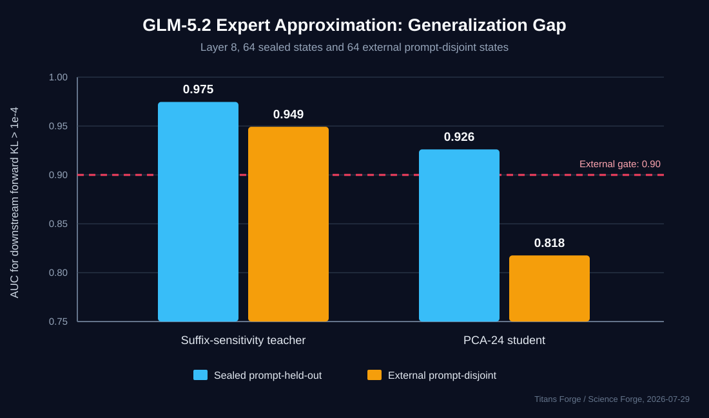

# Running GLM-5.2 Is Not the Same as Preserving It

## A Prompt-Disjoint Causal Safety Result for Routed-Expert Approximation

**Titans Forge / Science Forge**

**Research note: July 29, 2026**

## Executive Result

Community runtimes have crossed the capacity barrier for GLM-5.2 on
128 GB-class Apple Silicon. A public MTPLX model card reports 5.93 decode
tokens per second at 84.1 GiB peak memory on an M5 Max by keeping a compact
resident core and streaming ternary experts from SSD.

That is a meaningful systems result. It does not answer a separate question:

> When an expert representation is approximated, substituted, compressed, or
> omitted, how do we know whether the approximation is safe for the rest of
> the model?

We tested that question at GLM-5.2 layer 8. An expensive downstream
suffix-sensitivity teacher generalized across a prompt-disjoint external
set:

| External teacher metric | Result |
|---|---:|
| States | 64 |
| Prompt groups | 8 |
| Spearman versus log downstream forward KL | 0.88036 |
| AUC for forward KL > 1e-4 | 0.94928 |
| AUC for forward KL > 1e-3 | 0.98148 |
| False negatives at the frozen strict threshold | 0 / 18 |
| Coverage at the frozen strict threshold | 50.00% |

This supports a narrow but important finding: **downstream directional
sensitivity is a real, generalizing signal of causal damage from expert
approximation.**

The cheap runtime estimator did not generalize well enough. A fixed PCA-24
ridge student looked strong under sealed prompt-held-out evaluation, then
failed two of three precommitted external gates:

| PCA-24 student metric | Sealed evaluation | External holdout | External gate |
|---|---:|---:|---:|
| AUC, KL > 1e-4 | 0.92611 | 0.81763 | >= 0.90 |
| AUC, KL > 1e-3 | 0.90179 | 0.86852 | descriptive |
| False-negative rate | 1 / 38, 2.63% | 1 / 18, 5.56% | <= 5% |
| Coverage | 31.25% | 40.63% | >= 20% |
| Teacher-score Spearman | 0.72775 | 0.62546 | descriptive |

The result is therefore not a deployment claim. It is evidence that
internal reconstruction or validation quality can materially overstate
out-of-distribution safety.

## Why This Matters Now

The local-inference frontier is moving from "can the weights be addressed?"
to "what quality was retained?" Current public work demonstrates several
important pieces:

- [MTPLX GLM-5.2 streaming](https://huggingface.co/OpensourceWTF/GLM-5.2-t158-MTPLX-streaming)
  reports a 10.6 GiB resident core, a 158.2 GiB streamed ternary expert bank,
  5.93 tok/s, and 84.1 GiB peak memory on M5 Max.
- [The MLX-LM expert-offload request](https://github.com/ml-explore/mlx-lm/issues/1438)
  documents the broader demand for SSD-backed expert streaming on
  memory-constrained Apple Silicon.
- [NPUMoE](https://arxiv.org/abs/2604.18788) reports static expert-capacity
  tiers, grouped expert execution, and load-aware graph residency for Apple
  Silicon NPUs.

These efforts primarily address capacity, placement, and throughput. Our
result addresses a complementary missing layer: **causal admission control
for approximate expert execution.**

The public MTPLX checkpoint's own model card explicitly marks the ternary
build as not quality-validated and reports no end-to-end HumanEval, MBPP, or
perplexity gate. That makes independent quality qualification a concrete,
acknowledged need rather than a speculative criticism. We have published the
[`GLM Streaming Safety Challenge V1`](GLM_STREAMING_SAFETY_CHALLENGE_V1.md)
as a common black-box, white-box, and systems evidence standard.

An approximation can have:

- low local reconstruction error but high downstream damage;
- high cosine similarity but a decision-changing directional error;
- acceptable average quality but rare catastrophic states;
- strong internal validation and weak prompt-disjoint transfer.

A runtime that reports only tokens per second, memory, perplexity, or average
benchmark retention can miss those failures.

## Experiment Design

### Target

- Model: GLM-5.2
- Routed layer: 8
- Decode calls per prompt group: 8
- Sealed development groups: 32 through 39
- External groups: 3, 7, 11, 15, 19, 23, 27, and 31
- Sealed states: 64
- External states: 64

The external prompt groups predated this mechanism and were excluded from
student preprocessing, fitting, rank choice, ridge choice, and threshold
selection.

### Teacher

The teacher measures aggregate label-free suffix sensitivity downstream of a
routed-expert intervention. Causal forward KL enters only after the teacher
score or student prediction is frozen.

The teacher is an evaluation instrument, not a cheap runtime feature. Its
value is establishing that the model contains a measurable signal associated
with downstream approximation risk.

### Student

The fixed students use only information available before native routed-expert
execution:

- hidden-state features;
- router logits;
- selected route identifiers and scores;
- a pre-existing uncertainty score.

Teacher values, native routed outputs, native final logits, causal KL,
acceptance labels, and post-hoc outcomes are excluded from student fitting.
Standardization, PCA, and ridge fitting occur inside prompt-disjoint folds.

The tested fixed family was:

| Student | External AUC > 1e-4 | External AUC > 1e-3 | Strict FN | Coverage |
|---|---:|---:|---:|---:|
| Scalar ridge | 0.54952 | 0.57963 | 2 / 18 | 20.31% |
| PCA-8 ridge | 0.80072 | 0.78148 | 1 / 18 | 37.50% |
| PCA-16 ridge | 0.80918 | 0.82407 | 1 / 18 | 32.81% |
| PCA-24 ridge | 0.81763 | 0.86852 | 1 / 18 | 40.63% |
| Combined ridge-8 | 0.74879 | 0.72407 | 1 / 18 | 29.69% |

No tested student passed the external safety gate.

## The Failure Is Informative

PCA-24 passed every sealed advancement threshold. Its external miss was not a
large population of obviously bad states. It was one harmful state:

- prompt group: 3
- decode call: 0
- predicted risk score: 0.53693
- frozen threshold: 0.60252
- teacher sensitivity: 0.88192
- downstream forward KL: 0.0003569

That single false negative moved the observed rate from a pass to 5.56%,
slightly above the 5% gate. More importantly, external ranking AUC fell from
0.926 to 0.818. Threshold adjustment on this holdout would be contamination,
so the holdout is now retired from student selection.

## What We Can Claim

1. The tested suffix-sensitivity teacher generalized across a second,
   prompt-disjoint 64-state GLM-5.2 set.
2. Teacher sensitivity strongly ranked downstream causal damage at layer 8.
3. The tested linear pre-native students retained useful signal but did not
   meet the precommitted external gate.
4. Sealed-set success was not sufficient evidence of runtime safety.
5. Quality validation for streamed or reconstructed experts should include
   prompt-disjoint causal intervention tests, not only local error or average
   benchmark retention.

## What We Cannot Claim

- This does not establish a sub-100 GB GLM-5.2 runtime.
- This does not measure the quality of MTPLX, SAOD, or another external
  implementation.
- This does not establish task-level quality preservation.
- This does not establish multilayer composition safety.
- This does not show that suffix sensitivity can yet be estimated cheaply
  enough for production.
- This does not establish that layer 8 behavior generalizes to every layer.
- The fixed student implementation remains awaiting human promotion and its
  owned adversarial test suite requires expansion.

## Next Falsifier

The next experiment must not tune against the consumed external set.

1. Expand teacher-labeled training data across new prompt groups.
2. Freeze a third prompt pack before nonlinear student development.
3. Test runtime-cheap interaction models using hidden-router products,
   selected-expert identity embeddings, temporal decode features, and
   calibrated abstention.
4. Keep causal outcomes evaluation-only.
5. Replicate the teacher at one early and one late routed layer.
6. Require a fresh external gate of AUC >= 0.90, false-negative rate <= 5%,
   and coverage >= 20%.
7. Only then compose approximation across multiple layers or claim a safe
   memory reduction.

## Reproducibility

The companion
[`results/glm_5_2_suffix_risk_external_validation_v1.json`](results/glm_5_2_suffix_risk_external_validation_v1.json)
contains the aggregate metrics, frozen thresholds, prediction digests,
governance state, and source-artifact hashes.

Raw prompts, token IDs, activations, expert weights, model caches, and local
filesystem paths are intentionally excluded.
